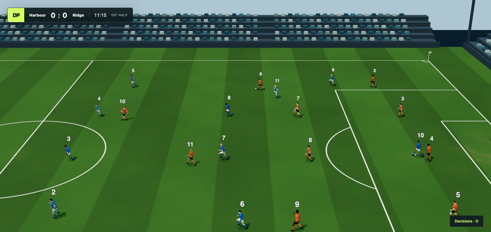

# Decision Pitch

Fast decision models play a real-time soccer match in 3D. Every player is
driven by a decision model and each team is managed by a language model that
picks the line-up, guides players and makes substitutions. There are no
turns: each model is asked again as soon as its answer is applied, so a
faster model acts more often while the match keeps running.

It is a sibling of [Decision Arena](https://github.com/eandualem/decision-arena),
where the same models race in a runner game.



**Status:** early. Decision models or built-in bots play a full match on the
page, and each team's manager picks their models and makes substitutions. See [docs/decisions.md](docs/decisions.md)
for the design and [docs/protocol.md](docs/protocol.md) for the match stream.

## Run it

You need [uv](https://docs.astral.sh/uv/).

```bash
uv run decision-pitch
```

With no keys, that match is played by the built-in bots. To watch a decision
model play with no keys, install Laya once and give it a team. Laya runs on
your computer, and its first start downloads about 850 MB:

```bash
uv tool install 'laya[serve]'
uv run decision-pitch --home laya --away bot
```

The page opens in your browser at `http://127.0.0.1:8000/` and a match starts
each time it connects. Use `--port` to change the port, `--no-browser` to start
without opening it and `--half-length` to set the length of each half in
seconds (default 180).

To play a match without the page and print what happens (with bots on both
teams it runs as fast as it can):

```bash
uv run decision-pitch --headless --seed 1
```

## Choose the models

Each team is played by the built-in bot unless you name the decision models its
manager may choose from with `--home` and `--away`, separated by commas. One
name puts the whole team on that model:

```bash
uv run decision-pitch --home laya --away bot
uv run decision-pitch --home laya,jev,bot --away clef
```

| Name | Model | Needs |
|---|---|---|
| `bot` | The built-in bot | Nothing |
| `laya` | Laya, run on this computer | `uv tool install 'laya[serve]'` once; its first start downloads about 850 MB |
| `d1` | Liquid's d1-3B, run on this computer | llama.cpp's `llama-server`; its first start downloads about 2.9 GB |
| `jev` | Jev at TypeSafe | `TYPESAFE_API_KEY` |
| `openai` | GPT-6 Luna Decisions | `OPENAI_API_KEY` |
| `perplexity` | Perplexity Decider | `PERPLEXITY_API_KEY` |
| `aplomb` | EmpirioLabs' Aplomb 1 | `EMPIRIO_LABS_API_KEY` |
| `microsoft`, `liquid` | Microsoft Decision-1 and Liquid D1, through Vercel's AI Gateway | `AI_GATEWAY_API_KEY` |
| `clef` | Cloudflare's Clef-flash | `CLOUDFLARE_ACCOUNT_ID` and `CLOUDFLARE_AUTH_TOKEN` |

With no keys, Laya and the bots play a full match. To use the others, copy
`.env.example` to `.env` and fill in the keys you have; the names are Decision
Arena's, so one `.env` serves both. At startup each model with a key is asked
one question, and one that does not answer is named with the key to check.

## Choose the managers

Each team has a manager. Before kick-off it picks a model for every player
from the ones it may choose, and during the match it is consulted every 15
seconds with a feed of the game: it can give a player a one-line instruction,
which the player reads with its state, and substitute a player, bringing on a
substitute with a model of its choice at the next stoppage. Press O on the
page to see every player's model, latest decision and answer time, and the
managers' instructions and substitutions.

The built-in manager (`builtin`, the default) needs nothing: it picks models
by their typical answer times and substitutes by simple rules. A language
model can manage instead, through Anthropic's API with `ANTHROPIC_API_KEY`
or OpenAI's API with `OPENAI_API_KEY`:

```bash
uv run decision-pitch --home laya,bot --home-manager anthropic --away-manager builtin
```

`anthropic` uses `claude-haiku-5-5` and `openai` uses `gpt-5.4-mini`; name
another model with `anthropic:MODEL` or `openai:MODEL`.
`--assistants 1` or `2` gives each language-model manager assistant models
(`claude-haiku-5-5` or `gpt-5.4-nano`) that send it a short note before each
consultation. A
language-model manager is asked about 25 times a team in a match of two
three-minute halves, each time with about 1,000 tokens.
A model that answers faster acts more often: each player asks its model again
as soon as its last answer is applied, and keeps carrying out that answer
while it waits.

## Laws of the game

| Law | Status |
|---|---|
| Kick-off, at the start, after half time and after a goal | Implemented. Opponents stay outside the centre circle; players out of place run back and the kick-off waits for them, for up to 10 s |
| Ball in and out of play | Implemented. The ball is out when it has wholly crossed a line, on the ground or in the air |
| Goals | Implemented |
| Throw-ins | Implemented. Opponents stay 2 m away. A foul throw cannot happen: the thrower always throws with both hands from where the ball went out |
| Goal kicks | Implemented. Opponents leave the penalty area until the kick is taken; it is taken once none is within 9.15 m of the ball, and one that had no time to leave may stay |
| Corners | Implemented. Opponents stay 9.15 m away |
| Two halves and half time | Implemented, with a change of ends and added time for goals, penalties, substitutions and cards |
| Goalkeepers | Implemented. A goalkeeper can handle the ball, so play it higher and further, in its own penalty area, except a ball a teammate deliberately kicked or threw to it, which it plays with its feet. A goalkeeper holding the ball for more than eight seconds concedes a corner, with the referee's count shown for the last five |
| Saves and deflections | Implemented. A ball faster than 18 m/s bounces off any player it reaches; a goalkeeper at full stretch parries a shot instead of catching it, so a parry or block can give a corner |
| Playing the ball twice at a restart | Implemented: an indirect free kick to the opponents |
| Goals that may not be scored directly from a restart | Implemented. A throw-in straight into the opponents' goal is a goal kick, and into the thrower's own goal a corner. An own goal straight from a kick-off, goal kick, corner or free kick is a corner, and a goal straight from an indirect free kick does not count |
| Fouls | Implemented for challenges on the player with the ball: a standing or slide tackle from behind, a tackle that takes the player and not the ball, and running into the carrier from behind or without being able to reach the ball. A fouled player goes down. Off the ball, running into an opponent from behind where the ball is contested is a foul. Handball is judged from where the ball meets a player, since players have no arms: a ball at arm height and wide of the body, not from close by |
| Free kicks and penalties | Implemented. Opponents stay 9.15 m away, with a wall near goal; at a penalty only the taker and the goalkeeper on its line stay in the area and arc |
| Advantage | Implemented: when the fouled team can play on in the opponents' half, play goes on, and comes back for the free kick if the opponents win the ball within 3 s |
| Offside | Implemented, judged when a teammate kicks the ball, with an indirect free kick. Interfering with an opponent without playing the ball is not judged yet |
| Yellow and red cards | Implemented: a yellow for stopping a promising attack or a slide tackle from behind, a red for denying an obvious goal-scoring opportunity or a second yellow. A tackle in the offender's own penalty area is one card lower, as the penalty gives the chance back. A sent-off player leaves the match; a team with fewer than seven ends it |
| Substitutions | Implemented in the engine: five substitutes, at most three stoppages besides half time, made at the next stoppage, as the managers ask for them. A substitute takes the place and position of the player it replaces |

## Test it

```bash
uv run pytest
```
