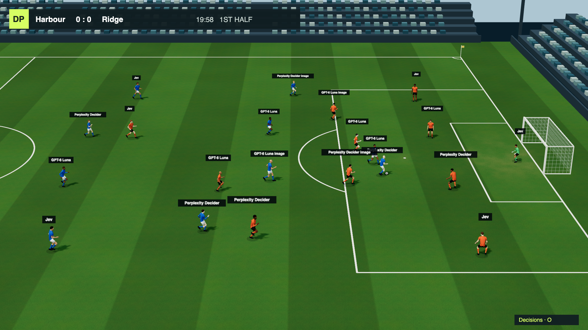

# Decision Pitch

**22 AI players. Two managers. One real-time soccer match.**

Fast decision models play soccer in 3D. Language-model managers pick the lineups,
give instructions and make substitutions. The match keeps moving while models
think: a faster answer gives a player another chance to react.



## Try it

You need Git, [uv](https://docs.astral.sh/uv/) and a browser with WebGL.
Python 3.12 or newer is required; uv can install it. No JavaScript build is needed.

```bash
git clone https://github.com/eandualem/decision-pitch.git
cd decision-pitch
uv tool install 'laya[serve]'
uv run decision-pitch
```

**No API keys needed.** By default, Laya runs the players on both teams and
built-in managers select the lineups. The first start downloads about 850 MB;
allow time for that and for the two local model processes to start.

The game opens at `http://127.0.0.1:8000/`. A match has two 90-second halves,
plus stoppages and half time. Each browser connection starts its own match.
Stop the server with Ctrl+C.

- **O** opens the Decisions panel: player models, actions, answer times,
  manager instructions and substitutions.
- **P** or **Pause** freezes play and new requests. Press again to resume.
- **Play again** starts another match after full time.

[More run options →](docs/running.md)

## How it works

- **Players choose an action:** pass, shoot, press, mark and more. Each sees
  the ball, teammates, opponents, its current action and its manager’s guidance.
  Vision variants also receive an overhead pitch image.
- **Managers choose the team:** which model plays each position, how to defend,
  what to tell players and when to substitute. Use the built-in managers or
  connect language models.
- **The engine handles the football:** movement, pass targets, physics and rules.
  Both teams share the same engine and state format.

There are no turns. Each player keeps carrying out its last action while waiting
for the next answer. Models choose actions, not exact coordinates or pass recipients.

[How decisions work →](docs/model-decisions.md)

## Bring your own models

Offer each manager a pool of decision models with `--home` and `--away`:

```bash
uv run decision-pitch --home laya,jev --away clef
```

Local models include Laya and Liquid d1. API options include Jev, GPT-6 Luna
Decisions, Perplexity Decider, Aplomb, Microsoft Decision-1, Liquid D1 and Clef.
Some also support image inputs. API players need their provider’s credentials
and incur usage charges.

Managers can use Anthropic’s API or an OpenAI model through the Codex CLI’s
ChatGPT login. Player API usage and manager usage are separate.

[Model setup](docs/running.md#choose-the-models) ·
[Manager setup](docs/running.md#choose-the-managers) ·
[Optional Langfuse tracing](docs/running.md#inspect-manager-requests-in-langfuse)

## An experiment in progress

Complete matches include restarts, fouls, penalties, cards, offside and
substitutions. The football still needs work: players can bunch up, attacks can
stall, and the formation is fixed at 4-4-2. Headers, aerial duels and offside
interference without playing the ball are not implemented. The displayed scorer
is approximate; team scores are correct.

Use it to explore decisions under time pressure. Results reflect the models,
shared football logic, provider limits and manager choices together; one match
is not a model ranking.

[Implemented rules and limits →](docs/rules.md)

## Explore and contribute

Decision Pitch is a sibling of [Decision Arena](https://github.com/eandualem/decision-arena),
which races decision models in a runner game. It reuses Arena’s model adapters
and timing approach.

Changes go through pull requests into `develop`; `main` contains promoted
releases. Record design changes in [Design decisions](docs/decisions.md).
Keep credentials in your environment or an ignored `.env` file.

```bash
uv run pytest
node --test tests/web/*.test.mjs
```

Node.js is only needed for the browser tests. Tests use fake or recorded responses.

[Match protocol](docs/protocol.md) · [Figure assets](assets/figure/README.md) ·
[Third-party notices](src/decision_pitch/web/THIRD_PARTY.md)

[MIT licensed](LICENSE). Original figures, kits, animation and soccer engine.
Reused code retains its notices: [Decision Arena](src/decision_pitch/arena/LICENSE)
and [Entune](src/decision_pitch/ENTUNE_LICENSE).
